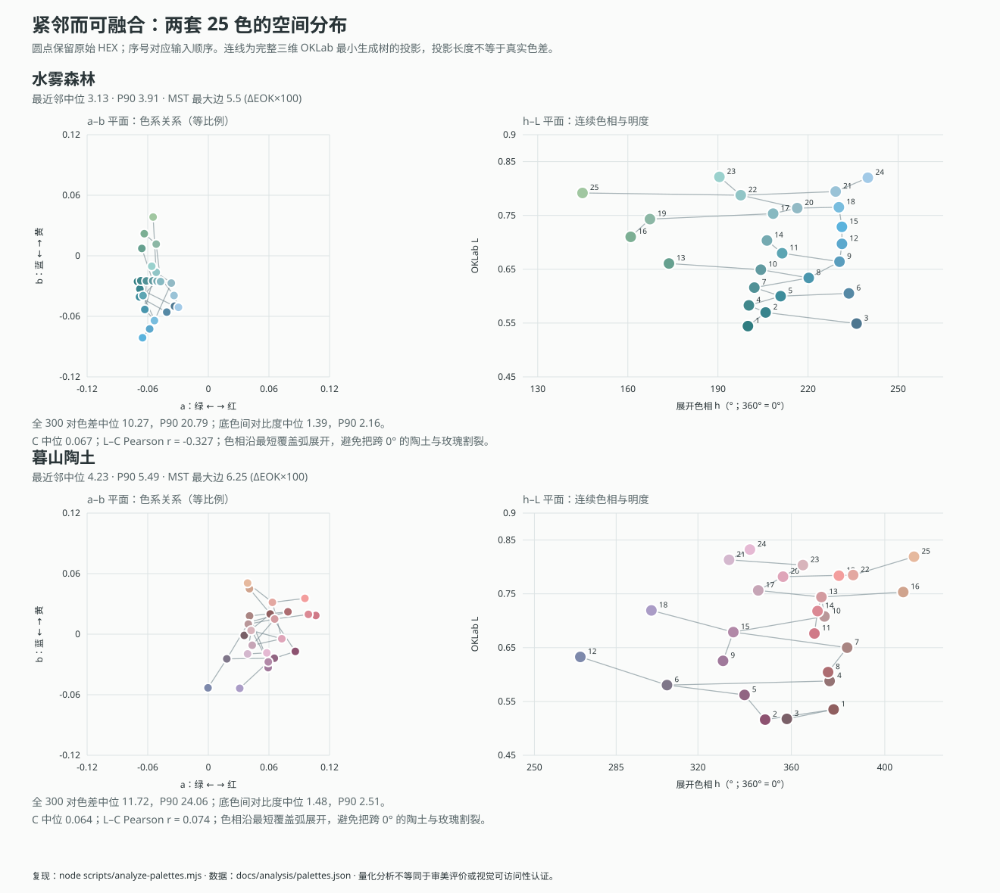

# 水雾森林与暮山陶土：配色目标与分布证据

这两套配色呈现的是**有限色系内的连续变化**：每种颜色都能找到近邻，近邻又能连成整体，同时保留多个相近色相的方向。生成目标应当是沿主色之间的连续路径小步探索，并在路径附近扩展；扩大色相范围、再尽可能拉开所有颜色，会把这一目标改变为“覆盖更多色彩空间”。

两套原始色表均保留 25 个精确 HEX，未校正、重排或替换。暮山陶土来自用户提供的原表；水雾森林来自项目已有原表。预设示例、选取的生成主色、生成结果是三份不同的数据。以下量化分析只针对原始色表，不是生成算法的实验成绩。



图中圆点使用实际原色，右图数字对应原输入顺序；SVG 圆点的 `title` 含 HEX 与坐标。左图为等比例 a–b 投影；右图为展开的 h–L 投影。连线是完整三维 OKLab 空间的最小生成树（MST）投影，**二维画面上的线长不等于真实色差**。JSON 中保存了所有坐标、300 对关系、25 条最近邻记录与 24 条 MST 边。

## 可复核方法

从实际 8 位 sRGB HEX 线性化后计算相对亮度与 OKLab，L/C/h 由同一坐标转换得到。使用项目的 `src/color.ts` 实现，坐标矩阵来自 [OKLab 原始说明](https://bottosson.github.io/posts/oklab/)。

- 色差统一为 `100 × √(ΔL² + Δa² + Δb²)`，下文简写为 ΔE。它是 ΔEOK 的 100 倍，不能当作 CIEDE2000。
- 每套 25 色完整计算 `25 × 24 / 2 = 300` 对；底色对比度为 `(较高相对亮度 + 0.05) / (较低相对亮度 + 0.05)`。
- 每个颜色取一个最近邻，得到 25 条距离；互为最近邻的一对会出现两次。
- 在所有 300 条边上用 Prim 算法求 MST，得到 24 条连边。最长 MST 边表示使整套颜色保持连通所需的最大单步跨度；它不受原表排列影响。
- 分位数使用 R-7 线性插值，排序后位置为 `(n − 1) × p`。所有数据保留浮点精度，表格仅对显示值舍入。
- 色相采用最小覆盖圆弧；暮山陶土跨过 0°，因此连续表示为 `269.66° → 360° → 412.52°`，末端等于 `52.52°`。

在项目目录运行：

```powershell
node scripts/analyze-palettes.mjs
```

该命令重新生成 [全部原始数据](analysis/palettes.json) 和 [SVG 空间图](analysis/palette-distributions.svg)，同时执行黑白对比 21、跨零色相、分位数插值、25/300/24 计数、原输入倒序后距离统计不变等自检。统计纯函数在 `src/palette-analysis.ts`，不包含生成阈值，也不把原表作为候选池。

## 重点是分布和邻接，而非一对极值

| 指标 | 水雾森林 | 暮山陶土 |
| --- | ---: | ---: |
| 25 个最近邻 ΔE：中位数 | 3.133 | 4.228 |
| 最近邻 ΔE：P90 | 3.907 | 5.492 |
| 最近邻 ΔE：最大值 | 5.501 | 6.253 |
| 24 条 MST 边 ΔE：中位数 | 3.337 | 4.317 |
| MST 边 ΔE：P90 | 4.153 | 5.665 |
| MST 边 ΔE：最大值 | 5.501 | 6.253 |
| 全 300 对 ΔE：P10 | 3.871 | 5.273 |
| 全 300 对 ΔE：P25 | 6.334 | 7.297 |
| 全 300 对 ΔE：中位数 | 10.270 | 11.724 |
| 全 300 对 ΔE：P75 | 15.672 | 18.558 |
| 全 300 对 ΔE：P90 | 20.793 | 24.064 |
| 全 300 对 ΔE：最小值 / 最大值 | 1.486 / 27.984 | 2.540 / 31.726 |
| 底色间对比：P10 | 1.083 | 1.094 |
| 底色间对比：P25 | 1.188 | 1.198 |
| 底色间对比：中位数 | 1.394 | 1.475 |
| 底色间对比：P75 | 1.748 | 1.958 |
| 底色间对比：P90 | 2.156 | 2.510 |
| 底色间对比：最大值 | 2.835 | 3.417 |

两套的最近邻与 MST 边距都较小，说明不是几组互不相接的孤立色团。与此同时，300 对距离的中位数明显大于最近邻中位数，最深与最浅颜色也相距较远。用户所说的“间距都不是很大”，适合在实现中解释为**每个点有可融合的近邻，整套能以小步连通**；机械要求任意两点都很近，会压掉原例中实际存在的深浅层次与色系变化。

单独让最近邻越来越小也不够：两团各自很密、彼此很远的颜色仍可能获得很小的最近邻中位数。MST 的 P90 和最长边用来补足这一缺口。反过来，MST 本身也不能证明“好看”，还需要保留主色方向、适度彩度，以及实际应用中的视觉判断。

## 色系如何相邻，以及为何不是单色灰阶

| 分布 | 水雾森林 | 暮山陶土 |
| --- | ---: | ---: |
| L：P10 / 中位数 / P90 | 0.575 / 0.697 / 0.793 | 0.546 / 0.708 / 0.809 |
| L：完整范围 | 0.544–0.822 | 0.516–0.832 |
| C：P10 / 中位数 / P90 | 0.053 / 0.067 / 0.083 | 0.041 / 0.064 / 0.096 |
| C：完整范围 | 0.0456–0.1041 | 0.0305–0.1080 |
| 最小覆盖色相弧 | 144.91°–239.91°，95.00° | 269.66°→52.52°，142.86° |
| L 与 C 的 Pearson 相关系数 | −0.327 | +0.074 |
| 相对亮度 Y 与 C 的 Pearson 相关系数 | −0.355 | +0.029 |
| 全对 ΔE 与对比度的 Pearson 相关系数 | +0.969 | +0.971 |

按便于解释的固定色相区间作人工分组，水雾森林为雾绿 4 色、蓝绿 11 色、雾蓝 10 色；暮山陶土为陶土 8 色、玫瑰 7 色、藕紫 9 色、灰蓝 1 色。分界是解释标签，**不代表原表恰好存在这些离散聚类**；临界处的颜色可以有不同命名。准确区间和成员见 JSON 的 `families` 字段，其中玫瑰区间 `[350°,15°)` 跨零。

森林通过绿色—蓝绿—雾蓝连接；陶土通过灰蓝—藕紫—玫瑰—陶土连接。陶土中的灰蓝 `#7D89AB` 是少量偏冷方向，周围的紫调为其提供过渡；并不要求每个色系平均占相同数量。

两者中位彩度都约为 0.06，色相变化不会呈现高彩度色环那样强烈的撞色。以同 L、C = 0.06 为例，色相转动 20° 对应的 ΔE 约为 `100 × 2 × 0.06 × sin(10°) ≈ 2.08`。因此色相角覆盖较宽并不自动等于跳脱，颜色之间在实际感知坐标中的路径才是重点。

森林有轻微“越亮越柔”的趋势；陶土几乎没有 L 与 C 的线性关系。原例不支持“所有颜色必须按明度同步降低彩度”的统一规则。两者也都保留了有意义的彩度下限，不能通过把 C 推近零来伪造协调。较高的全对 ΔE—对比度相关系数说明大跨度主要跟深浅变化有关，**不代表**色相方向可以被删掉；a–b 图显示了仍然存在的横向色系关系。

## 白字对比与规则边界

| 白字与 25 个底色的对比 | 水雾森林 | 暮山陶土 |
| --- | ---: | ---: |
| 最小值 / 中位数 / 最大值 | 1.697 / 2.646 / 4.811 | 1.720 / 2.642 / 5.877 |
| P10 / P90 | 1.878 / 4.235 | 1.843 / 5.117 |
| 达到 1.65 的颜色数 | 25 / 25 | 25 / 25 |
| 达到 3 的颜色数 | 11 / 25 | 11 / 25 |
| 达到 4.5 的颜色数 | 2 / 25 | 4 / 25 |

`1.65` 是保留这类浅色风格的工程阈值；`4.5` 是 WCAG 常规正文 AA 的最低对比要求，二者不能混称。改变滑杆会改变可行颜色：白字阈值提高到 4.5 后，两套原表大多数浅色都不能原样用于该文字组合。[W3C 对比度说明](https://www.w3.org/WAI/WCAG22/Understanding/contrast-minimum.html)

暮山陶土的原始底色跨度为 3.417，因此其预设规则明确取 `maxBackgroundContrast = 3.5`；不能声称它符合水雾森林的 3.0 上限。其余示例规则保留最小 ΔE 1.4、彩度上限 0.11、白字阈值 1.65。这些是工作参数，不是对原色表的重写。

## 生成器应该优化什么

本次修正前的逻辑给自动域加上 L ±0.14、C ±0.06、h 两端各 ±70°，再用 maximin 不断选择“离已有集合最近距离最大”的颜色。前一步引入主色没有表达的色系，后一步奖励远离已有颜色；两者叠加，会倾向于把允许空间铺满。这种目标适合强调可区分性的分类配色，却不符合本工具要形成统一风格的目的。

更符合原例的设计约束是：

1. 当前主色决定风格范围。在已有候选池机制上缩小自动域的过宽余量，把主色及相近色系之间的区域作为主要探索位置；手动范围负责裁剪允许区域，不能转而成为要均匀填满的目标。
2. 在已有三轮贪心补点中，改进候选评分，使新颜色优先补充局部层次与过渡，均衡考虑 L、C、h。只调整明度会退化成单色阶；跨越灰心的直线插值可能削弱彩度，需要保留连续的色相与彩度方向。
3. 最小色差是避免近乎重复的下界，不再被当作越大越好的总目标。最近邻与 MST 分位数用于解释生成的局部结构，全对分位数用于观察整体跨度。
4. 保留原 HEX 主色与全部硬约束。紧邻风格不是放宽文字对比或悄悄改色；不相容时应明确报告。对于相距很远的用户主色，也不能假装有少量小步一定能桥接。

这份分析延续 [既有算法说明](ALGORITHM.md) 与 [研究来源](SOURCES.md) 的数学定义和职责边界。改进应保留确定性种子、Halton 候选采样、三轮尝试、量化后硬审计、局部替换与失败处理；改动集中于过宽的自动域和把最远距离当奖励的评分。MST 在本报告中用于诊断整体连通性，**不替代全对最小色差、底色最大对比和文字最低对比等硬约束，也不要求推翻原有搜索流程**。

这些测量只来自两套 25 色样本，可以支持目标修正与回归比较，不能据此宣布一组阈值是通用审美定律。

## 暮山陶土的六个生成起点

六个代表主色是本次的**工程选取**，用于显式加载后的生成探索；它们不是用户给定的“唯一正确主色”，也不替代完整 25 色原例。

| 主色 | 作用 |
| --- | --- |
| `#8F5E5F` | 较深陶土，提供深色端与暖调基底。 |
| `#916582` | 较深藕紫，连接冷暖与明度层次。 |
| `#7D89AB` | 灰蓝方向，保留原例少量偏冷的变化。 |
| `#D07A88` | 玫瑰方向，保留较高彩度而不走向灰阶。 |
| `#D4B8CE` | 浅藕紫，提供柔和的亮部方向。 |
| `#E6B99E` | 浅陶土，提供亮部暖色端。 |

只读示例的审计范围由全 25 原色推导；显式“使用主色”时一并加载这份范围和底色规则，保留工作台文字设置。点击“重置为主色范围”后按当前六个输入重算边界。修改工作台主色不会改变示例。
